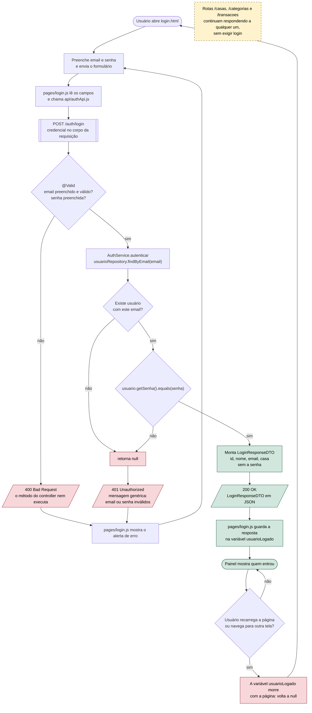
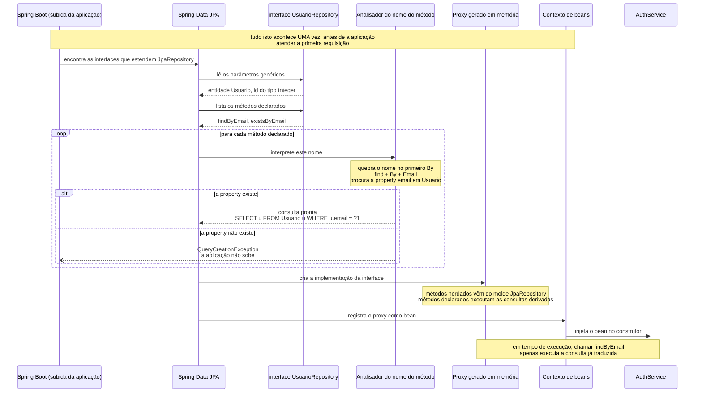
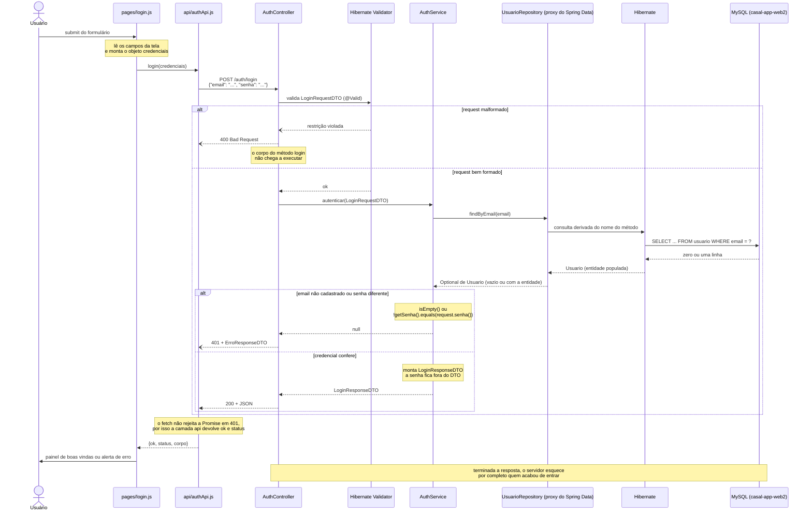

# Aula 10: autenticação, parte 1. O fluxo de login

> **Aviso ao estudante.** O código desta aula é **propositalmente inseguro**. A senha será
> comparada em texto puro e ficará legível no banco de dados. Isso não é descuido: é o
> primeiro passo de uma sequência de quatro aulas, e cada aula seguinte corrige um defeito
> que esta deixa exposto. Nada daqui deve ser copiado para um sistema real sem as aulas 11,
> 12 e 13.

## Revisão: onde a aula 9 nos deixou

Na aula anterior o projeto ganhou a entidade `Usuario`, associada a uma `Casa`, com um CRUD
completo e validação de request via Bean Validation. A entidade guarda três campos de
interesse imediato:

```java
@Entity
@Table(name = "usuario")
public class Usuario {

    @Id
    @GeneratedValue(strategy = GenerationType.IDENTITY)
    private int id;

    private String nome;
    private String email;
    private String senha;

    @ManyToOne
    @JoinColumn(name = "casa_id")
    private Casa casa;
```

Repare no que já existe e no que ainda não existe. **Existe** um lugar para guardar email e
senha. **Não existe** nenhuma rota capaz de responder à pergunta mais básica de qualquer
aplicação com usuários: *este par de email e senha corresponde a alguém cadastrado?*

Toda a aula de hoje serve para responder exatamente essa pergunta, e nada além dela.

---

## 1. Três conceitos que costumam ser confundidos

Antes de escrever uma linha de código, vale separar três ideias que a linguagem cotidiana
mistura dentro da palavra "login".

| Conceito | Pergunta que ele responde | Exemplo no `casalapp` |
|---|---|---|
| **Identificação** | Quem você afirma ser? | O usuário digita `ana@casa.com` no formulário. |
| **Autenticação** | Você consegue provar essa afirmação? | O sistema confere se a senha enviada bate com a senha cadastrada para aquele email. |
| **Autorização** | Já que provou, o que você tem permissão de fazer? | A Ana pode ver as transações da casa dela, mas não as de outra casa. |

A aula de hoje implementa **apenas a autenticação**. A autorização, que é o passo de
realmente proteger as rotas existentes, depende de o sistema conseguir reconhecer o usuário
em requisições posteriores, e isso é assunto das aulas 12 e 13.

Essa separação explica, de passagem, por que a autenticação é sempre uma rota própria
(`/auth/login`) e não um campo escondido nos endpoints de `Usuario`. O CRUD de `/usuarios`
responde "quais usuários existem"; o `/auth/login` responde "você é um deles".

---

### 1.1 O fluxo completo, em um diagrama de atividade

Antes de descer ao código, vale ter o mapa do que vamos construir. O diagrama de atividade
abaixo (também disponível em [`aulas/10_auth_login_fluxo.mmd`](10_auth_login_fluxo.mmd))
mostra o caminho inteiro, do clique no botão até a resposta na tela, com cada ponto de decisão
explícito.



Leia o diagrama observando três coisas, pois são elas que organizam a aula.

1. **Há três saídas possíveis**, e cada uma tem um código de status HTTP diferente. O `400`
   acontece antes de qualquer consulta ao banco, decidido pelo `@Valid` da aula 9. O `401`
   acontece em dois pontos distintos do fluxo, e repare que ambos desembocam na **mesma**
   resposta, por um motivo que a seção 6.3 vai detalhar. O `200` é o único caminho que chega
   a montar um DTO de resposta.
2. **O losango do final, em vermelho, é o assunto das próximas aulas.** Entrar no sistema não
   deixa nenhuma marca durável: recarregar a página devolve o usuário à estaca zero.
3. **O retângulo amarelo, solto à direita, não se conecta a nada.** Isso não é um descuido do
   desenho: é a representação fiel do estado do projeto ao final desta aula. As rotas de
   negócio continuam atendendo qualquer um, completamente alheias ao fluxo de login que
   acabamos de desenhar.

---

## 2. Um identificador não pode ser ambíguo

O login que vamos escrever busca o usuário **pelo email**. Essa decisão tem uma consequência
imediata que o modelo atual ainda não garante: se duas linhas da tabela `usuario` tiverem o
email `ana@casa.com`, a pergunta "qual é a senha da Ana?" passa a ter duas respostas
possíveis, e o conceito de autenticação se desfaz.

Antes de buscar por um campo, portanto, é preciso garantir que ele identifique **uma** linha.
Isso é responsabilidade do banco de dados, declarada na entidade:

```java
    @Column(unique = true, nullable = false)
    private String email;
```

| Atributo | Efeito no DDL gerado |
|---|---|
| `unique = true` | Cria uma restrição de unicidade na coluna. O próprio banco passa a recusar um `INSERT` com email repetido. |
| `nullable = false` | Cria a coluna como `NOT NULL`. Um usuário sem email seria um usuário impossível de autenticar. |

### 2.1 Um efeito colateral do `ddl-auto=update`

A aula 8 configurou `spring.jpa.hibernate.ddl-auto=update`. Ao subir a aplicação agora, o
Hibernate tentará alterar a tabela existente para adicionar a restrição de unicidade. Se o
banco já tiver usuários de teste com emails repetidos, essa alteração **falha**, e a
aplicação não sobe.

Isso não é um bug da ferramenta: é a demonstração prática do limite discutido na aula 8.
`ddl-auto` sabe criar estrutura nova, mas não sabe decidir o que fazer com dados antigos que
contradizem a estrutura nova. Nesse caso, a decisão é humana: apagar ou corrigir as linhas
duplicadas antes de subir.

```sql
SELECT email, COUNT(*) FROM usuario GROUP BY email HAVING COUNT(*) > 1;
```

### 2.2 Quem deve recusar o email repetido

A restrição no banco impede o dado inconsistente, mas a mensagem que ela produz é uma
exceção de driver SQL, que chegaria ao cliente da API como um `500 Internal Server Error`.
Um `500` significa "o servidor quebrou"; aqui o servidor não quebrou nada, apenas recebeu um
pedido inválido. A regra, então, também precisa existir na camada de `service`, onde ela pode
ser traduzida em uma resposta compreensível:

```java
    public UsuarioResponseDTO criar(UsuarioRequestDTO request) {
        if (usuarioRepository.existsByEmail(request.email())) {
            return null;
        }
        ...
    }
```

```java
    @PostMapping("/usuarios")
    public ResponseEntity<Object> criarUsuario(@Valid @RequestBody UsuarioRequestDTO request) {
        UsuarioResponseDTO novo = usuarioService.criar(request);

        if (novo == null) {
            return ResponseEntity.status(409).body(new ErroResponseDTO("já existe um usuário com este email"));
        }

        return ResponseEntity.status(201).body(novo);
    }
```

O status `409 Conflict` é o adequado: o request está bem formado (um `400` não cabe) e a rota
existe (um `404` não cabe), mas o estado atual do servidor é incompatível com o que se pede.
Note que a verificação no `service` **não substitui** a restrição no banco. Entre o
`existsByEmail` e o `save` existe um intervalo de tempo no qual outro request pode inserir o
mesmo email. A restrição do banco é a garantia final; a checagem no `service` existe para
produzir uma boa mensagem no caso comum.

---

## 3. Os métodos mágicos do `repository`

Chegamos ao recurso que mais costuma causar desconfiança em quem aprende Spring Data, e com
razão. Vamos dedicar uma seção inteira a ele.

Até esta aula, todos os repositórios do projeto usaram apenas métodos **herdados** de
`JpaRepository` (`findById`, `findAll`, `save`, `existsById`, `deleteById`). A aula 8 explicou
de onde eles vêm: `JpaRepository` é um molde genérico, parametrizado com a entidade e o tipo
do `@Id`, e o Spring Data gera em tempo de execução uma implementação desse molde.

Para buscar por email, porém, precisamos de algo que o molde não oferece. Nenhuma biblioteca
poderia ter previsto que o nosso projeto teria uma entidade com um atributo chamado `email`.
A solução do Spring Data é a seguinte:

```java
public interface UsuarioRepository extends JpaRepository<Usuario, Integer> {

    Optional<Usuario> findByEmail(String email);

    boolean existsByEmail(String email);
}
```

Declaramos dois métodos e **não escrevemos implementação nenhuma**. Nem SQL, nem JPQL, nem
corpo de método, nem anotação. Ainda assim eles funcionam. Esse é o recurso conhecido como
**consultas derivadas** (*derived query methods*), ou, informalmente, os métodos mágicos do
repository.

### 3.1 Onde está a mágica, exatamente

Não há mágica, há leitura de texto. Convém desfazer o mistério logo, porque entender o
mecanismo é o que permite usá-lo com segurança.

Lembre que `UsuarioRepository` é uma **interface**, e uma interface não executa nada. Alguém
precisa fornecer o objeto concreto que o `AuthService` recebe no construtor. Quem fornece é o
Spring Data, durante a subida da aplicação, em três passos:

1. **Varredura.** O Spring Data encontra todas as interfaces que estendem `JpaRepository` e,
   para cada uma, descobre a entidade e o tipo do id pelos parâmetros genéricos.
2. **Análise dos nomes.** Para cada método **declarado** na interface, isto é, cada método que
   não é herdado do molde, ele lê o **nome do método como se fosse uma frase** e tenta
   traduzi-lo em uma consulta.
3. **Geração do objeto.** Ele cria em memória uma classe que implementa a interface, um objeto
   chamado *proxy*, no qual cada método declarado executa a consulta traduzida no passo
   anterior. Esse objeto é registrado como *bean*, e é ele que chega ao `service` por injeção
   de dependência.

A consequência prática é importante: o trabalho acontece **na inicialização**, não a cada
chamada. Quando o `AuthService` invoca `findByEmail`, a consulta já estava pronta desde o
momento em que a aplicação subiu.

O diagrama de sequência abaixo detalha essa conversa de inicialização, que é invisível no
código e, por isso mesmo, a parte que costuma ficar obscura. Ele também está em
[`aulas/10_repository_proxy_sequencia.mmd`](10_repository_proxy_sequencia.mmd).



Perceba que o `AuthService` entra na história apenas no fim, quando recebe por injeção de
dependência um objeto que ninguém escreveu. Perceba também onde está o `QueryCreationException`:
dentro do laço de análise dos nomes, antes de qualquer proxy existir. Voltaremos a esse ponto
na seção 3.6.

### 3.2 A gramática: como o nome é lido

O Spring Data divide o nome do método em duas partes, separadas pela primeira ocorrência da
palavra `By`.

```
      findBy          Email
      ╰────╯          ╰───╯
   o que fazer    como filtrar
    (sujeito)      (predicado)
```

A primeira parte diz **qual operação** realizar:

| Prefixo | Operação | Exemplo |
|---|---|---|
| `find` (ou `get`, `read`, `query`, `search`) | Busca e devolve os dados. | `findByEmail` |
| `exists` | Devolve apenas `true` ou `false`. | `existsByEmail` |
| `count` | Devolve a quantidade de linhas, em `long`. | `countByCasaId` |
| `delete` (ou `remove`) | Apaga as linhas encontradas. | `deleteByCasaId` |

A segunda parte, depois do `By`, diz **quais atributos** entram no filtro. E aqui está o ponto
que merece mais atenção de todos:

> O que vem depois do `By` é o nome do **atributo da entidade Java**, escrito exatamente como
> está na classe, e **não** o nome da coluna no banco de dados.

No nosso caso os dois nomes coincidem, porque o atributo se chama `email` e a coluna também.
Mas se a entidade tivesse `@Column(name = "end_eletronico") private String email`, o método
continuaria sendo `findByEmail`, nunca `findByEndEletronico`. O Spring Data trabalha no nível
do **modelo de objetos**, e deixa a tradução para nome de coluna por conta do Hibernate, que
é quem conhece as anotações de mapeamento. Essa é a mesma divisão de responsabilidades que a
aula 8 estabeleceu entre JPA e banco.

A primeira letra do atributo aparece em maiúscula no nome do método apenas por causa da
convenção `camelCase` do Java. `findByEmail` procura pelo atributo `email`.

### 3.3 Combinando critérios

A gramática não para em um atributo. Ela aceita operadores lógicos e comparações, e é aí que
o recurso se mostra realmente útil. Exemplos aplicados às entidades que o `casalapp` já tem:

| Método declarado | Consulta que o Spring Data deriva |
|---|---|
| `findByNome(String nome)` | `WHERE nome = ?` |
| `findByEmailAndSenha(String email, String senha)` | `WHERE email = ? AND senha = ?` |
| `findByNomeOrEmail(String nome, String email)` | `WHERE nome = ? OR email = ?` |
| `findByNomeContaining(String parte)` | `WHERE nome LIKE %?%` |
| `findByNomeIgnoreCase(String nome)` | `WHERE UPPER(nome) = UPPER(?)` |
| `findByValorGreaterThan(Double valor)` | `WHERE valor > ?` |
| `findByValorBetween(Double min, Double max)` | `WHERE valor BETWEEN ? AND ?` |
| `findByCasaIsNull()` | `WHERE casa_id IS NULL` |
| `findByNomeStartingWith(String inicio)` | `WHERE nome LIKE ?%` |
| `findByNomeOrderByIdDesc(String nome)` | `WHERE nome = ? ORDER BY id DESC` |
| `findTop3ByOrderByValorDesc()` | as três linhas de maior valor |

Duas regras governam essas combinações:

1. **A ordem dos parâmetros do método é a ordem em que os critérios aparecem no nome.** Em
   `findByEmailAndSenha(String email, String senha)`, o primeiro argumento vai para o `email`
   e o segundo para a `senha`. Trocar a ordem dos parâmetros na declaração, mantendo o nome do
   método, produz uma consulta logicamente errada que compila sem reclamação alguma. É um erro
   difícil de perceber, e vale conferir sempre.
2. **A quantidade de parâmetros precisa casar com a quantidade de critérios.** Palavras como
   `IsNull` e `IsNotNull` não consomem parâmetro, pois a condição já está dita no nome;
   `Between` consome dois.

### 3.4 Navegando por relacionamentos

A gramática também atravessa `@ManyToOne`, seguindo as referências de objeto em vez de
escrever `JOIN` na mão. Como `Usuario` tem um atributo `casa` do tipo `Casa`, e `Casa` tem um
atributo `nome`, é possível declarar:

```java
    List<Usuario> findByCasaNome(String nome);
```

O Spring Data interpreta `CasaNome` como "o atributo `nome` do atributo `casa`", e gera o
`JOIN` entre as duas tabelas automaticamente. Compare com o que a aula 4 fazia à mão, com
dois laços encaixados, e com o que a aula 8 passou a fazer via `getCasa().getNome()`.

Essa interpretação é ambígua em um caso: se a entidade `Usuario` tivesse, ela mesma, um
atributo chamado `casaNome`, o Spring Data daria preferência a ele e nunca faria o `JOIN`.
Para desfazer a ambiguidade de forma explícita, usa-se o sublinhado como separador dos níveis:

```java
    List<Usuario> findByCasa_Nome(String nome);
```

O sublinhado quebra a convenção de nomes do Java, e por isso só deve aparecer quando houver
ambiguidade real.

### 3.5 Os tipos de retorno possíveis

O tipo declarado no retorno não é decorativo: ele informa ao Spring Data **quantos resultados
esperar** e o que fazer quando a realidade não corresponder.

| Retorno declarado | Significado | Quando não encontra nada |
|---|---|---|
| `Optional<Usuario>` | Espera-se no máximo um resultado. | `Optional.empty()`, sem exceção. |
| `Usuario` | Espera-se no máximo um resultado. | Devolve `null`. |
| `List<Usuario>` | Espera-se qualquer quantidade. | Lista vazia, **nunca** `null`. |
| `boolean` | Usado com o prefixo `exists`. | `false`. |
| `long` | Usado com o prefixo `count`. | `0`. |

Escolhemos `Optional<Usuario>` em `findByEmail` por dois motivos. Primeiro, porque a restrição
de unicidade da seção 2 garante que existe no máximo um usuário por email, e o tipo expressa
essa garantia no código. Segundo, porque não encontrar ninguém é um resultado normal de um
login, e o `Optional` obriga o `AuthService` a tratar esse caso explicitamente, em vez de
deixar um `null` circulando até estourar um `NullPointerException` em outro lugar.

Há uma armadilha aqui que vale conhecer. Se declarássemos `Optional<Usuario>` ou `Usuario` em
uma consulta que **pode** devolver mais de uma linha, por exemplo `findByNome`, e o banco
devolvesse duas, o Spring Data lançaria uma exceção
(`IncorrectResultSizeDataAccessException`) em tempo de execução. O tipo de retorno é uma
afirmação sobre os dados, e ele será cobrado.

### 3.6 Quando o erro aparece

Esta é a principal diferença entre o método mágico e um método normal, e o motivo pelo qual
o recurso incomoda quem o encontra pela primeira vez. Considere um erro de digitação:

```java
    Optional<Usuario> findByEmai(String email);
```

Nada acontece na compilação. O `mvn compile` passa sem um aviso, porque, para o compilador
Java, essa linha é apenas a declaração de um método em uma interface, perfeitamente válida.
O compilador não tem como saber que `Emai` deveria ser um atributo de `Usuario`, pois essa
regra não existe na linguagem Java: ela existe na biblioteca.

O erro aparece na **subida da aplicação**, no passo 2 descrito na seção 3.1, com uma mensagem
parecida com esta:

```
org.springframework.data.repository.query.QueryCreationException:
Could not create query for public abstract java.util.Optional
br.edu.ifpr.casalapp.repository.UsuarioRepository.findByEmai(java.lang.String);
Reason: Failed to create query for method; No property 'emai' found for type 'Usuario'
```

A lição é dupla. Por um lado, o erro chega cedo, antes de a aplicação atender qualquer
requisição, o que é muito melhor do que descobrir o problema em produção. Por outro, convém se
acostumar a ler os erros de inicialização do Spring, pois uma parte dos defeitos que em outras
abordagens o compilador pegaria aqui se manifesta nesse momento.

Essa é também a razão de a mensagem de erro falar em `property` e não em `coluna`: o Spring
Data está procurando um atributo no modelo Java, exatamente como a seção 3.2 descreveu.

### 3.7 O limite do recurso, e a saída

Métodos mágicos resolvem bem o caso comum, que é filtrar por igualdade em alguns atributos.
Eles param de compensar em dois cenários.

O primeiro é quando a consulta é complexa. Um método chamado
`findByCasaNomeAndValorGreaterThanAndDataBetweenOrderByValorDesc` é tecnicamente válido e
humanamente ilegível. Quando o nome do método passa a ser mais difícil de ler do que a
consulta que ele representa, o recurso está sendo usado contra o seu propósito.

O segundo é quando a consulta simplesmente não cabe na gramática, por exemplo uma soma
agrupada ou um `JOIN` com condição incomum. Para esses casos existe a saída explícita, a
anotação `@Query`, na qual se escreve a consulta em JPQL (a linguagem de consulta da JPA, que
opera sobre entidades em vez de tabelas):

```java
    @Query("SELECT u FROM Usuario u WHERE u.email = :email")
    Optional<Usuario> buscarPorEmail(@Param("email") String email);
```

Com `@Query`, o nome do método deixa de ser interpretado como frase e passa a ser apenas um
nome, livremente escolhido. Não vamos usar `@Query` nesta aula, pois `findByEmail` é o caso
mais simples possível de consulta derivada, mas é importante saber que a porta de saída existe
e que optar por ela não é derrota: é escolher a ferramenta certa quando a mágica deixou de
ajudar.

O resumo da seção, para levar para a próxima aula: o repository do Spring Data oferece três
camadas de recurso, e a escolha entre elas é uma decisão de projeto.

| Camada | Quando usar |
|---|---|
| Métodos herdados de `JpaRepository` | Operações por id e listagens completas. |
| Consultas derivadas do nome do método | Filtros simples e legíveis em poucos atributos. |
| `@Query` com JPQL | Consultas que a gramática não expressa ou que o nome não comportaria. |

---

## 4. Os DTOs do login

Três DTOs novos, cada um com uma responsabilidade estrita.

### 4.1 `LoginRequestDTO`, o que entra

```java
public record LoginRequestDTO(
        @NotBlank(message = "email é obrigatório")
        @Email(message = "email inválido") String email,
        @NotBlank(message = "senha é obrigatória") String senha) {
}
```

Poderíamos ter reaproveitado `UsuarioRequestDTO`, que já tem email e senha. Seria um erro
conceitual. `UsuarioRequestDTO` descreve **um usuário a ser cadastrado**, e por isso exige
`nome` e `casaId`. Quem está entrando no sistema não envia nome nem casa: envia uma
credencial. São dois contratos diferentes, logo dois records diferentes. Reaproveitar o
primeiro obrigaria o front a inventar valores para campos que não fazem sentido no login.

### 4.2 `LoginResponseDTO`, o que sai

```java
public record LoginResponseDTO(int usuarioId, String nome, String email, int casaId, String casaNome) {}
```

Este record responde "quem acabou de entrar". Observe o que ele **não** contém: a senha.
A mesma disciplina que a aula 9 aplicou ao `UsuarioResponseDTO` vale aqui, e com ainda mais
razão. Devolver em um JSON de login a senha que o próprio cliente acabou de enviar não
acrescenta informação alguma e multiplica os lugares por onde o segredo passa (o log do
servidor, o cache do navegador, o histórico do Swagger).

Esse é o argumento concreto, e não apenas estético, para a regra da aula 5 de nunca devolver
a entidade diretamente: se o `controller` devolvesse o objeto `Usuario`, a senha iria no JSON
automaticamente, porque o campo existe na classe.

### 4.3 `ErroResponseDTO`, o que sai quando dá errado

```java
public record ErroResponseDTO(String mensagem) {}
```

Até esta aula, todas as respostas de erro do projeto eram corpos vazios
(`ResponseEntity.notFound().build()`) ou o JSON padrão que o Spring monta para o `400` do
Bean Validation. Um login malsucedido é o primeiro caso em que a aplicação precisa **explicar**
a recusa para que o front possa mostrar algo ao usuário. Um record de uma linha resolve, e
mantém o formato do erro igual em toda a API.

---

## 5. `AuthService`, onde a decisão acontece

```java
@Service
public class AuthService {

    private final UsuarioRepository usuarioRepository;

    public AuthService(UsuarioRepository usuarioRepository) {
        this.usuarioRepository = usuarioRepository;
    }

    public LoginResponseDTO autenticar(LoginRequestDTO request) {
        Optional<Usuario> usuarioOpt = usuarioRepository.findByEmail(request.email());

        if (usuarioOpt.isEmpty()) {
            return null;
        }

        Usuario usuario = usuarioOpt.get();

        if (!usuario.getSenha().equals(request.senha())) {
            return null;
        }

        Casa casa = usuario.getCasa();
        int casaId = casa != null ? casa.getId() : 0;
        String casaNome = casa != null ? casa.getNome() : null;

        return new LoginResponseDTO(
                usuario.getId(),
                usuario.getNome(),
                usuario.getEmail(),
                casaId,
                casaNome
        );
    }
}
```

O método tem exatamente a forma que a definição de autenticação sugere: busca o usuário pela
identificação, confere a prova, e devolve quem é. São duas condições de falha, e as duas
devolvem o mesmo `null`.

Por que criar um `AuthService` em vez de colocar um método `autenticar` dentro do
`UsuarioService` já existente? Porque as responsabilidades são distintas. `UsuarioService`
cuida do ciclo de vida do cadastro (criar, listar, alterar, excluir). `AuthService` cuida da
verificação de credencial. Nas próximas aulas ele vai crescer bastante, acumulando a geração
e a validação de token, e essa separação é o que evitará um `UsuarioService` de quinhentas
linhas tratando de dois assuntos sem relação.

### 5.1 A linha problemática

```java
        if (!usuario.getSenha().equals(request.senha())) {
```

Guarde esta linha. Ela compara duas `String`s de senha em texto puro, o que significa que a
senha legível está armazenada no banco. A aula 11 existe para eliminá-la.

Observe também que a comparação usa `equals` e não `==`. Em Java, `==` entre objetos compara
**referências**, isto é, se são o mesmo objeto na memória; `equals` em `String` compara o
**conteúdo**. A senha que veio do JSON e a senha que veio do banco são sempre dois objetos
distintos, portanto `==` resultaria em `false` mesmo para a senha correta. Esse é um erro
clássico, e aqui ele produziria um sistema em que ninguém jamais consegue entrar.

---

## 6. `AuthController` e o significado dos códigos de status

```java
@RestController
public class AuthController {

    private final AuthService authService;

    public AuthController(AuthService authService) {
        this.authService = authService;
    }

    @Operation(summary = "Autentica um usuário a partir do email e da senha")
    @PostMapping("/auth/login")
    public ResponseEntity<Object> login(@Valid @RequestBody LoginRequestDTO request) {
        LoginResponseDTO autenticado = authService.autenticar(request);

        if (autenticado == null) {
            return ResponseEntity.status(401).body(new ErroResponseDTO("email ou senha inválidos"));
        }

        return ResponseEntity.ok(autenticado);
    }
}
```

### 6.1 Por que `POST`, e não `GET`

O login não é uma consulta comum, embora pareça: ele apenas verifica dados e nada altera no
banco. A razão de ser `POST` é outra. Em um `GET`, os dados vão na URL, e a URL é registrada
no histórico do navegador, nos logs do servidor e nos logs de qualquer proxy no caminho.
Uma senha em `/auth/login?senha=1234` é uma senha publicada. O `POST` leva a credencial no
corpo da requisição, que não é registrado em nenhum desses lugares por padrão.

### 6.2 Por que `401`, e não `404`

Quando `autenticar` devolve `null`, o `controller` responde `401 Unauthorized`.

| Status | Significado | Por que não serve aqui |
|---|---|---|
| `400 Bad Request` | O request está malformado. | O request está perfeito: tem email válido e senha preenchida. O problema é o conteúdo não corresponder a ninguém. |
| `404 Not Found` | O recurso pedido não existe. | O recurso pedido é a rota `/auth/login`, e ela existe. |
| `403 Forbidden` | Sei quem você é, e você não pode fazer isso. | Ainda não sabemos quem é. `403` é resposta de autorização, assunto da aula 13. |
| `401 Unauthorized` | Falta credencial válida. | É exatamente o caso. |

O nome `401 Unauthorized` é historicamente infeliz, pois o que ele descreve é falha de
**autenticação**, não de autorização. A especificação HTTP atual reconhece isso
explicitamente. Vale memorizar o par: `401` significa "não sei quem você é"; `403` significa
"sei quem você é e ainda assim não pode".

### 6.3 Uma única mensagem para duas falhas diferentes

O `service` devolve `null` tanto quando o email não existe quanto quando a senha está errada,
e o `controller` responde a mesma frase, "email ou senha inválidos", nos dois casos. Isso é
deliberado.

Suponha que a API respondesse "email não cadastrado" no primeiro caso e "senha incorreta" no
segundo. Qualquer pessoa poderia então usar o formulário de login como consulta: digitando
emails com uma senha qualquer, descobriria **quais emails têm conta no sistema**. Em um
aplicativo de finanças de casal, saber que determinado email está cadastrado já é informação
sensível, e ela ainda facilita o ataque seguinte, que é tentar senhas apenas nos emails
confirmados. A mensagem genérica custa um pouco de clareza para o usuário honesto e remove
esse canal de informação. Esse tipo de vazamento tem nome, **enumeração de usuários**, e a
decisão de evitá-lo é padrão na indústria.

### 6.4 `ResponseEntity<Object>`

O método devolve `ResponseEntity<Object>` porque o corpo tem dois tipos possíveis,
`LoginResponseDTO` no sucesso e `ErroResponseDTO` na falha, e um genérico só aceita um tipo.
Essa é a solução direta para esta aula. Existe uma alternativa mais elegante, que é tratar o
erro em um `@RestControllerAdvice` centralizado e manter a assinatura tipada em
`ResponseEntity<LoginResponseDTO>`. Fica registrada como caminho de evolução, pois exige
exceções personalizadas que o projeto ainda não tem.

---

### 6.5 O caminho completo de uma requisição de login

O diagrama de atividade da seção 1.1 mostrou *quais* decisões são tomadas. O diagrama de
sequência abaixo mostra *quem conversa com quem* para tomá-las, incluindo as duas camadas do
frontend e as duas peças do backend que trabalham abaixo do `repository`. Ele também está em
[`aulas/10_auth_login_sequencia.mmd`](10_auth_login_sequencia.mmd).



Vale comparar este diagrama com o da aula 8, que descrevia o fluxo genérico de uma requisição
qualquer. A espinha dorsal é idêntica, pois o login não inventa arquitetura nenhuma: é mais um
`controller` chamando um `service`, que chama um `repository`, que delega ao Hibernate. Quatro
detalhes, porém, são novos e merecem atenção.

1. **O Hibernate Validator aparece antes do `AuthService`.** Ele é a primeira peça a tocar o
   request, e quando ele reprova, nenhuma linha do nosso código executa.
2. **A camada `api/` devolve três campos, e não apenas o corpo.** Como a nota do diagrama
   registra, o `fetch` considera um `401` uma requisição bem sucedida, assunto da seção 8.1.
3. **A senha aparece em apenas dois lugares do desenho**, na mensagem de ida do navegador e na
   comparação dentro do `AuthService`. Ela não aparece em nenhuma mensagem de volta. Esse é o
   desenho que `LoginResponseDTO` garante.
4. **A última nota é a mais importante da aula.** Quando a resposta termina de ser enviada,
   nada no servidor registra que aquele login aconteceu. O próximo request chegará tão anônimo
   quanto o primeiro, e é exatamente esse esquecimento que as aulas 12 e 13 vão atacar.

---

## 7. Testando pelo Swagger e pelo terminal

Com a aplicação no ar, a nova rota já aparece documentada em
`http://localhost:8080/swagger-ui/index.html`, sem configuração adicional, porque o
springdoc lê os `@RestController` do projeto. Vale reparar que o campo `senha` aparece
marcado como obrigatório na documentação **porque o Hibernate Validator leu o `@NotBlank`**,
o mesmo mecanismo discutido na aula 9.

Pelo terminal, com `curl`:

```bash
curl -i -X POST http://localhost:8080/auth/login \
  -H "Content-Type: application/json" \
  -d '{"email":"ana@casa.com","senha":"1234"}'
```

Convém testar as três respostas possíveis e confirmar que cada uma vem com o status correto:

| Entrada | Resposta esperada |
|---|---|
| Email e senha corretos | `200` com o `LoginResponseDTO`. |
| Email correto, senha errada | `401` com `{"mensagem":"email ou senha inválidos"}`. |
| Email inexistente | `401`, com a **mesma** mensagem. |
| Campo `senha` ausente no JSON | `400`, produzido pelo `@Valid` antes de o método rodar. |

---

## 8. A tela de login no frontend

O front segue a separação em camadas estabelecida na aula 9. O login acrescenta um arquivo em
cada uma delas, sem exceção à regra.

```
casalapp-frontend/
  login.html
  js/
    api/
      authApi.js
    pages/
      login.js
```

### 8.1 A camada `api/`

```js
async function login(credenciais) {
    const resposta = await fetch(API_BASE_URL + "/auth/login", {
        method: "POST",
        headers: { "Content-Type": "application/json" },
        body: JSON.stringify(credenciais)
    });

    const corpo = await resposta.json();

    return { ok: resposta.ok, status: resposta.status, corpo: corpo };
}
```

Esta função difere das demais funções de `api/` do projeto em um ponto: ela não devolve
apenas `await resposta.json()`, e sim um objeto que inclui `ok` e `status`.

A razão é que, até agora, o front vinha ignorando o status das respostas, o que funcionava
porque a camada `pages/` não tomava nenhuma decisão a partir dele. No login, o status **é** a
informação principal: a diferença entre entrar e não entrar está nele, não no corpo. A
propriedade `resposta.ok` do `fetch` é um atalho para "o status está na faixa 200 a 299".

Vale notar uma particularidade do `fetch` que surpreende quem vem de outras bibliotecas: um
`401` **não** faz a `Promise` ser rejeitada. Para o `fetch`, a requisição foi um sucesso,
afinal o servidor respondeu. Só falha de rede gera exceção. Por isso é obrigatório verificar
`resposta.ok` de forma explícita.

### 8.2 A camada `pages/`

```js
let usuarioLogado = null;

formLogin.addEventListener("submit", async function (evento) {
    evento.preventDefault();

    const credenciais = {
        email: campoEmail.value,
        senha: campoSenha.value
    };

    const resultado = await login(credenciais);

    if (!resultado.ok) {
        mostrarErro(resultado.corpo.mensagem ? resultado.corpo.mensagem : "não foi possível entrar");
        return;
    }

    usuarioLogado = resultado.corpo;
    mostrarUsuarioLogado();
});
```

A camada `pages/` faz o que sempre fez: lê os campos da tela, chama a camada `api/`, e
atualiza o DOM com o resultado. Nenhum `fetch` aqui, nenhuma URL montada aqui.

O ponto a observar é a variável `usuarioLogado`, no topo do arquivo. É aí, e somente aí, que
mora a informação de quem entrou. Uma variável JavaScript vive enquanto a página vive. Ao
pressionar F5, ou ao clicar em "Transações" no menu, o navegador descarta todo o ambiente da
página, a variável volta a `null`, e o usuário "deslogou" sem ter pedido.

Isso não é um defeito da implementação. É o estado natural da web: o HTTP não tem memória
entre requisições, e cada página carregada começa do zero. Perceber esse limite com clareza
é o objetivo pedagógico desta seção, porque é ele que motiva as aulas 12 e 13.

---

## 9. O que está errado neste código

Encerramos a aula com um inventário honesto dos defeitos, cada um ligado à aula que o
resolve. Esta é a parte mais importante do encontro.

**Primeiro, as senhas estão legíveis no banco.** Vale fazer a demonstração no terminal:

```sql
SELECT id, nome, email, senha FROM usuario;
```

As senhas de todos os usuários aparecem na tela. Qualquer pessoa com acesso de leitura ao
banco (uma cópia de backup, um estagiário, um invasor que explore outra falha qualquer)
obtém todas elas. E como as pessoas reaproveitam senhas, quem lê essa coluna provavelmente
obtém também o acesso ao email pessoal de cada usuário. Isso se resolve na **aula 11**, com
funções de hash.

**Segundo, a senha é enviada de novo em cada operação.** Hoje o problema está contido, porque
nenhuma outra rota pede credencial. Mas a consequência de manter esse desenho seria o front
guardar a senha para reenviá-la a cada clique, multiplicando as chances de ela vazar. Isso se
resolve na **aula 12**, trocando a senha por um token emitido uma vez.

**Terceiro, quem entrou é esquecido imediatamente.** O backend respondeu quem é o usuário e
em seguida esqueceu; o front guardou em uma variável que morre ao recarregar a página. Isso
se resolve na **aula 13**, persistindo o token no navegador.

**Quarto, e mais grave, nada está protegido.** Observe que `GET /transacoes`,
`POST /transacoes` e todas as demais rotas continuam exatamente como estavam: respondem a
qualquer um, sem perguntar nada. A tela de login que acabamos de construir é, neste momento,
pura decoração. Um `curl` direto no endpoint ignora o login por completo.

Essa é a lição central da aula: **autenticar não protege nada por si só**. Autenticação apenas
descobre quem é quem. Proteger as rotas é autorização, e ela só se torna possível quando o
servidor consegue reconhecer o usuário em requisições subsequentes. Até lá, o cadeado existe
mas a porta está escancarada.

---

## 10. Atividade

A atividade desta aula está em
[atividades/10_auth_login_atividade.md](atividades/10_auth_login_atividade.md). Ela tem três partes: exercitar as
consultas derivadas no `UsuarioRepository` (inclusive provocando de propósito o erro de
inicialização da seção 3.6), estender a proteção de email único aos métodos `atualizar` e
`atualizarParcial`, e analisar por escrito o que esta aula deixou exposto.

---

## Referências

Documentação oficial dos recursos usados nesta aula.

1. Spring Data JPA, consultas derivadas do nome do método:
   https://docs.spring.io/spring-data/jpa/reference/jpa/query-methods.html
2. Spring Data JPA, palavras aceitas na gramática dos nomes de métodos:
   https://docs.spring.io/spring-data/jpa/reference/repositories/query-keywords-reference.html
3. Spring Data JPA, anotação `@Query` e consultas declaradas em JPQL:
   https://docs.spring.io/spring-data/jpa/reference/jpa/query-methods.html#jpa.query-methods.at-query
4. Spring Data, tipos de retorno aceitos em métodos de consulta:
   https://docs.spring.io/spring-data/jpa/reference/repositories/query-return-types-reference.html
5. Jakarta Persistence, a linguagem de consulta JPQL (especificação, capítulo 4):
   https://jakarta.ee/specifications/persistence/3.2/jakarta-persistence-spec-3.2#a4665
6. Jakarta Persistence, anotação `@Column`:
   https://jakarta.ee/specifications/persistence/3.2/apidocs/jakarta.persistence/jakarta/persistence/column
7. Jakarta Bean Validation, restrições padrão (`@NotBlank`, `@Email`):
   https://jakarta.ee/specifications/bean-validation/3.1/apidocs/jakarta/validation/constraints/package-summary
8. Spring Framework, `ResponseEntity`:
   https://docs.spring.io/spring-framework/docs/current/javadoc-api/org/springframework/http/ResponseEntity.html
9. RFC 9110, HTTP Semantics, seção 15.5.2, `401 Unauthorized`:
   https://www.rfc-editor.org/rfc/rfc9110.html#name-401-unauthorized
10. RFC 9110, HTTP Semantics, seção 15.5.10, `409 Conflict`:
   https://www.rfc-editor.org/rfc/rfc9110.html#name-409-conflict
11. MDN, API `fetch` e por que erros HTTP não rejeitam a Promise:
   https://developer.mozilla.org/pt-BR/docs/Web/API/Window/fetch
12. MDN, propriedade `Response.ok`:
   https://developer.mozilla.org/pt-BR/docs/Web/API/Response/ok
13. OWASP, Authentication Cheat Sheet, respostas genéricas de erro de login:
   https://cheatsheetseries.owasp.org/cheatsheets/Authentication_Cheat_Sheet.html
