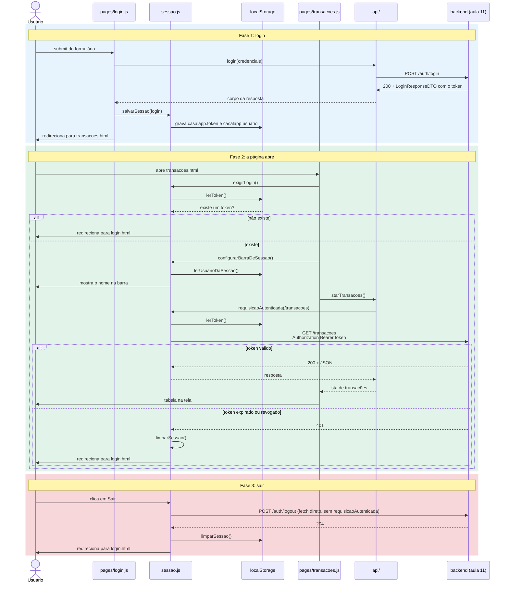
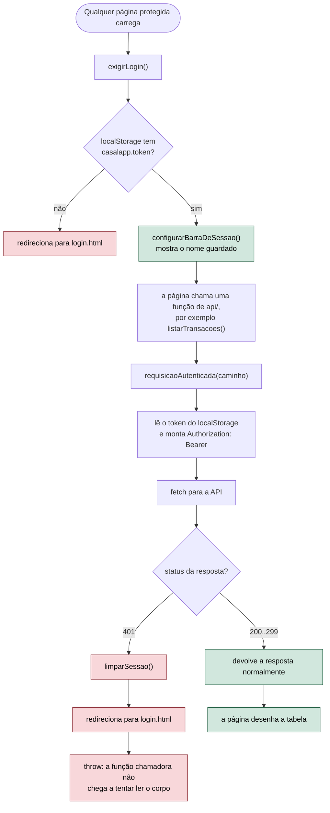

# Aula 12: autenticação, parte 3. A sessão no navegador

> **Aviso ao estudante.** A aula 11 fechou o esquema de autenticação do lado do servidor: hash
> de senha, token opaco e proteção de rotas por interceptor. Mas um servidor seguro não basta se
> o navegador não souber cooperar com ele. Esta aula ensina o lado que falta: como o frontend
> guarda o token, como ele o reapresenta em cada chamada e como ele se comporta quando a sessão
> deixa de valer.

## Revisão: o que o backend já resolveu, e o que sobrou para o navegador

A aula 10 fechou com um inventário de quatro defeitos. A aula 11 resolveu os dois primeiros e
deixou o terceiro pela metade.

| Defeito apontado na aula 10 | O que a aula 11 fez | O que falta |
|---|---|---|
| Senha legível no banco | Hash com BCrypt. | Nada, está resolvido. |
| Senha reenviada a cada operação | Token opaco, emitido uma vez no login. | Nada, está resolvido. |
| Quem entrou é esquecido imediatamente | O **servidor** passou a lembrar, numa linha da tabela `token`. | O **navegador** ainda esquece a cada F5, porque continua sem nenhum código que leia esse token de volta. |
| Nada está protegido | `HandlerInterceptor` recusa quem não apresenta um token válido. | Nada, está resolvido no servidor. |

A terceira linha é o assunto de hoje. Repare na distinção que ela introduz, e que vai organizar
a aula inteira: existem **duas** memórias diferentes em jogo, a do servidor e a do navegador, e
cada uma esquece de um jeito diferente. O servidor esquece se alguém apagar a linha do token, o
que só acontece em um `logout` ou numa expiração. O navegador esquece **sempre**, porque cada
página carregada é um ambiente novo e nenhuma variável sobrevive a um recarregamento. A aula 10
já tinha mostrado isso, com a variável `usuarioLogado` que voltava a `null` a cada F5. O token da
aula 11 não mudou essa física nenhum pouco: ele só deu ao navegador algo que vale a pena guardar
de um jeito mais durável do que uma variável.

---

## 1. Onde guardar o token no navegador

Esta é a primeira decisão, e vale compará-la com as alternativas antes de escolher uma.

| Opção | Tempo de vida | Enviado automaticamente a cada requisição? |
|---|---|---|
| Variável JavaScript | Morre ao trocar ou recarregar a página. Era a solução da aula 10. | Não. |
| `sessionStorage` | Vive enquanto a aba estiver aberta. | Não. |
| `localStorage` | Persiste até ser apagado, inclusive depois de fechar o navegador. | Não. |
| *Cookie* | Prazo definido pelo servidor. | **Sim**, o navegador o anexa sozinho a cada requisição do mesmo domínio. |

Escolhemos o `localStorage`. A razão principal é didática: como ele não é enviado
automaticamente, é o nosso próprio código que precisa ler o valor e colocá-lo no cabeçalho, o
que mantém visível todo o mecanismo que esta aula estuda. Um *cookie* resolveria o transporte de
graça, mas escondendo exatamente o passo que queremos entender.

A escolha tem um custo, e um sistema bem projetado é aquele que conhece o custo das suas
escolhas, não aquele que finge que elas não existem. O `localStorage` é acessível a **qualquer**
código JavaScript executando naquela página, inclusive um script malicioso injetado por uma
falha de *cross site scripting* (XSS) em outro lugar do site. Um *cookie* marcado `HttpOnly` é
invisível para o JavaScript e, por isso, mais resistente a esse ataque específico, em troca de
ficar exposto a outro, o *cross site request forgery* (CSRF), que exige defesa própria. Nenhuma
das duas opções é gratuitamente superior à outra; a diferença é qual ataque cada uma neutraliza
e qual ela deixa em aberto.

---

## 2. Uma camada que não é `api/` nem `pages/`

A aula 9 organizou o frontend em duas camadas: `api/`, que conhece rotas do servidor, e
`pages/`, que toca no DOM da tela. O token precisa de um lugar para morar que não é nenhuma das
duas, porque ele não é uma chamada HTTP e não é uma manipulação de tela. Ele é **estado do
navegador**, e esse estado ganha um arquivo próprio.

```
casalapp-frontend/
  js/
    sessao.js
    api/
      authApi.js
    pages/
      login.js
      transacoes.js
```

### 2.1 Guardar, ler e apagar

```js
const CHAVE_TOKEN = "casalapp.token";
const CHAVE_USUARIO = "casalapp.usuario";

function salvarSessao(login) {
    localStorage.setItem(CHAVE_TOKEN, login.token);
    localStorage.setItem(CHAVE_USUARIO, JSON.stringify({
        usuarioId: login.usuarioId,
        nome: login.nome,
        email: login.email,
        casaNome: login.casaNome
    }));
}

function lerToken() {
    return localStorage.getItem(CHAVE_TOKEN);
}

function lerUsuarioDaSessao() {
    const guardado = localStorage.getItem(CHAVE_USUARIO);
    return guardado ? JSON.parse(guardado) : null;
}

function limparSessao() {
    localStorage.removeItem(CHAVE_TOKEN);
    localStorage.removeItem(CHAVE_USUARIO);
}
```

Duas observações valem a pena. Primeiro, o `localStorage` só guarda texto, nunca objetos, e é
por isso que os dados do usuário passam por `JSON.stringify` na gravação e por `JSON.parse` na
leitura. Segundo, e mais importante: os dados do usuário gravados ali, nome, email, casa, servem
**apenas** para a tela mostrar algo de imediato, sem esperar o servidor. Eles são uma cópia que
pode estar desatualizada, nunca a fonte da verdade. A fonte da verdade continua sendo o banco de
dados, acessível pela rota `GET /auth/eu` que a aula 11 construiu. Se a Ana trocar de casa, essa
cópia local vai mentir até a próxima vez que o frontend perguntar ao servidor.

### 2.2 Por que `sessao.js` existe como arquivo próprio

Poderíamos ter espalhado essas quatro funções pelos arquivos que precisam delas. A razão de não
fazer isso é a mesma que levou a aula 5 a separar `service` de `controller`: **todo** código do
frontend que precisa saber se existe uma sessão, qual é o token e como encerrá-la, converge para
este arquivo. Quando a aula 13 ou qualquer evolução futura mudar a forma de guardar a sessão, a
mudança acontece em um lugar, e não em uma caça ao tesouro por todos os arquivos do projeto.

---

## 3. O cabeçalho, montado em um lugar só

Até aqui, `sessao.js` só sabe ler e escrever no `localStorage`. A peça que faz a ponte entre essa
memória e as chamadas HTTP é esta:

```js
async function requisicaoAutenticada(caminho, opcoes) {
    const configuracao = opcoes ? opcoes : {};

    configuracao.headers = {
        "Content-Type": "application/json",
        "Authorization": "Bearer " + lerToken()
    };

    const resposta = await fetch(API_BASE_URL + caminho, configuracao);

    if (resposta.status === 401) {
        limparSessao();
        window.location.href = "login.html";
        throw new Error("sessão encerrada");
    }

    return resposta;
}
```

### 3.1 O que ela economiza

Compare o `casaApi.js` de antes da sessão existir com o de agora:

```js
// antes, sem sessão: cada função repetia URL base, cabeçalho e Content-Type
async function listarCasas() {
    const resposta = await fetch(API_BASE_URL + "/casas");
    return await resposta.json();
}

// agora, com requisicaoAutenticada
async function listarCasas() {
    const resposta = await requisicaoAutenticada("/casas");
    return await resposta.json();
}

async function criarCasa(dados) {
    const resposta = await requisicaoAutenticada("/casas", {
        method: "POST",
        body: JSON.stringify(dados)
    });
    return await resposta.json();
}
```

A `API_BASE_URL`, o `Content-Type` e o `Authorization` desaparecem de cada função de `api/`. O
ganho não é só digitação, é **garantia**: com o cabeçalho montado em um único ponto, nenhuma
função nova pode esquecer de enviá-lo, porque nenhuma função nova precisa sequer saber que ele
existe. É exatamente o raciocínio que, no backend, levou a verificação do token para um único
`HandlerInterceptor` em vez de repeti-la em cada `controller`. A mesma ideia, regra transversal
num lugar só, se aplica aos dois lados do fio.

### 3.2 O bloco do `401`, com atenção a dois detalhes

Vale ler essas quatro linhas devagar, porque elas escondem uma armadilha do `fetch` que surpreende
quem vem de outras bibliotecas.

```js
    if (resposta.status === 401) {
        limparSessao();
        window.location.href = "login.html";
        throw new Error("sessão encerrada");
    }
```

**Primeiro detalhe.** Para o `fetch`, um `401` não é uma falha de rede, é uma resposta HTTP
normal, e a `Promise` **não** é rejeitada por causa dele. Se o código não verificasse
`resposta.status` explicitamente, ele seguiria tentando ler `await resposta.json()` sobre uma
resposta de erro, e o que aconteceria a partir daí dependeria só de sorte.

**Segundo detalhe.** `window.location.href = "login.html"` manda o navegador trocar de página,
mas **não interrompe** a execução do código JavaScript que está correndo agora. Sem o `throw`
logo depois, a função que chamou `requisicaoAutenticada` continuaria, tentaria usar uma resposta
inválida, e o erro apareceria em outro lugar, mais difícil de rastrear até aqui. O `throw`
interrompe a cadeia de chamadas na hora, antes que qualquer dano aconteça.

---

## 4. Rotas privadas no frontend, e um limite importante

Cada página protegida do `casalapp` começa com duas linhas, antes de qualquer outra coisa:

```js
exigirLogin();
configurarBarraDeSessao();
```

```js
function exigirLogin() {
    if (!lerToken()) {
        window.location.href = "login.html";
    }
}
```

### 4.1 O que essas linhas são, e o que elas não são

É preciso ser muito claro sobre isto, porque é o ponto em que a aula pode ser mal interpretada:
**`exigirLogin` não protege nada**. Ela apenas evita que alguém sem token veja uma tela montada
em volta de dados que nunca vão chegar, cheia de tabelas vazias e mensagens de erro. É uma
conveniência de interface, pensada para quem está usando o sistema normalmente. Quem de fato
protege o dado é o `HandlerInterceptor` da aula 11, no servidor, e **somente** ele.

A diferença fica evidente num experimento simples, que vale repetir em sala: apagar as duas
linhas do início de `transacoes.js`, abrir a página sem nenhum token e observar o resultado. A
tela aparece, porque não existe mais nada no navegador impedindo. Mas as tabelas continuam
vazias, porque toda chamada feita por `requisicaoAutenticada` volta `401` do servidor, dispara o
bloco da seção 3.2 e devolve o usuário para o login. Nenhum dado de nenhuma casa escapa. A
conclusão, que vale memorizar: **a segurança nunca mora no cliente**, porque o cliente está
inteiramente nas mãos de quem o usa. O código JavaScript pode ser editado no console do
navegador, e as mesmas chamadas podem ser feitas direto por `curl`, sem passar por nenhuma tela.

### 4.2 Uma lacuna pequena, e deliberada

`exigirLogin` responde a uma pergunta mais estreita do que parece: "existe algum valor guardado
em `casalapp.token`?", e não "esse valor ainda é um token válido?". Um token expirado passa por
essa verificação sem problema, porque ele ainda existe no `localStorage`. A tela abre
normalmente, e é só na primeira chamada à API que o `401` aparece e a sessão é descartada. Isso é
aceitável porque, de novo, `exigirLogin` não é a proteção, é uma conveniência. A verificação que
importa de verdade acontece a cada chamada, no servidor.

---

## 5. Entrar e sair

### 5.1 O que `login.js` faz no sucesso

```js
    salvarSessao(resultado.corpo);
    window.location.href = "transacoes.html";
```

Compare com a aula 10, onde o sucesso guardava o usuário numa variável. Agora ele é entregue a
`sessao.js`, que o grava num lugar que sobrevive à troca de página.

### 5.2 Confirmar a sessão com o servidor ao abrir a tela

```js
async function conferirSessaoNoServidor() {
    if (!lerToken()) {
        return;
    }

    const usuario = await buscarUsuarioLogado();
    mostrarUsuarioLogado(usuario);
}
```

Esta função chama `GET /auth/eu`, a rota que a aula 11 construiu, e ela responde de uma vez a
três perguntas que o frontend sozinho não tem como responder: o token ainda existe na tabela do
servidor? ele já expirou? foi apagado por um `logout` feito em outro dispositivo? Se a resposta
for `401`, o bloco da seção 3.2 já cuida de limpar a sessão e devolver a pessoa ao login. O
frontend nunca precisa decidir isso por conta própria, porque ele não tem como saber: a fonte da
verdade é sempre o servidor.

### 5.3 Uma assimetria proposital no `logout`

Todas as chamadas autenticadas passam por `requisicaoAutenticada`, com uma única exceção:

```js
async function logout() {
    await fetch(API_BASE_URL + "/auth/logout", {
        method: "POST",
        headers: { "Authorization": "Bearer " + lerToken() }
    });
}
```

O `logout` usa `fetch` direto, sem passar pela função centralizada. Se ele passasse, e o token já
estivesse inválido, o `throw` do bloco de `401` interromperia a função antes de ela chegar a
`limparSessao`, e a pessoa ficaria presa com um token morto guardado no navegador. Sair do
sistema precisa funcionar mesmo quando a sessão já não vale, e essa é uma regra de projeto que
vale guardar de forma mais geral: uma operação de recuperação não pode depender da própria coisa
que pode estar quebrada.

---

## 6. O caminho inteiro, em dois diagramas

O diagrama de sequência abaixo acompanha as três fases da sessão vistas do lado do navegador, do
login à saída, incluindo o caminho que o `401` abre quando o token para de valer. Ele também está
em [`aulas/12_auth_frontend_sequencia.mmd`](12_auth_frontend_sequencia.mmd).



O segundo diagrama isola a decisão que toda página protegida toma sozinha, do `exigirLogin` até
o `401`, sem o detalhe de qual rota foi chamada. Ele também está em
[`aulas/12_auth_frontend_fluxo.mmd`](12_auth_frontend_fluxo.mmd).



Vale notar o que os dois diagramas **não** mostram: nenhuma caixa aqui decide se um dado pertence
a alguém. Essa decisão inteira aconteceu no backend, na aula 11. O frontend desta aula só cuida
de guardar, enviar e descartar um valor opaco, exatamente como a seção 3.2 daquela aula definiu o
significado da palavra.

---

## 7. O que ainda está em aberto

**A mesma falha de XSS discutida na seção 1 continua valendo.** Qualquer script que consiga
executar na página tem acesso de leitura ao `localStorage`, logo ao token. Nada no código desta
aula reduz esse risco; a defesa correta é impedir que um script estranho execute, o que é
assunto de sanitização de entrada e de política de conteúdo, fora do escopo desta disciplina.

**`exigirLogin` não distingue "sem token" de "token inválido".** A seção 4.2 já registrou essa
lacuna. Ela só custa uma tela que abre e imediatamente redireciona de volta, nunca um dado
vazado.

**Não existe aviso de sessão perto do fim.** Os oito horas de validade da aula 11 correm sem que
o frontend avise ninguém; a sessão simplesmente para de funcionar na próxima chamada, e a pessoa
descobre isso ao ser devolvida ao login. Um sistema mais maduro avisaria com antecedência, ou
renovaria o token silenciosamente.

**A barra de sessão mostra sempre os mesmos links a qualquer usuário autenticado.** O menu não
diferencia o que cada pessoa pode fazer, porque essa pergunta ainda não tem resposta em nenhuma
camada do projeto. Hoje, a diferença entre um usuário e outro aparece só nos dados que a API
devolve, nunca nos botões que a tela oferece.

---

## 8. Atividade

A atividade desta aula está em
[atividades/12_auth_frontend_atividade.md](atividades/12_auth_frontend_atividade.md). Ela pede
para aplicar o mesmo padrão de sessão a uma tela nova, provocar de propósito os dois modos de
falha estudados aqui, e analisar por escrito os limites que a seção 7 deixou em aberto.

---

## Referências

Documentação oficial dos recursos usados nesta aula.

1. MDN, `localStorage` e o escopo de armazenamento no navegador:
   https://developer.mozilla.org/pt-BR/docs/Web/API/Window/localStorage
2. MDN, API `fetch` e por que erros HTTP não rejeitam a Promise:
   https://developer.mozilla.org/pt-BR/docs/Web/API/Window/fetch
3. MDN, propriedade `Response.ok` e a faixa de status considerada sucesso:
   https://developer.mozilla.org/pt-BR/docs/Web/API/Response/ok
4. MDN, `Window.location` e a navegação por `location.href`:
   https://developer.mozilla.org/pt-BR/docs/Web/API/Window/location
5. RFC 6750, `The OAuth 2.0 Authorization Framework: Bearer Token Usage`:
   https://www.rfc-editor.org/rfc/rfc6750.html
6. OWASP, Session Management Cheat Sheet, armazenamento de identificadores de sessão no cliente:
   https://cheatsheetseries.owasp.org/cheatsheets/Session_Management_Cheat_Sheet.html
7. OWASP, Cross Site Scripting (XSS) Prevention Cheat Sheet:
   https://cheatsheetseries.owasp.org/cheatsheets/Cross_Site_Scripting_Prevention_Cheat_Sheet.html
